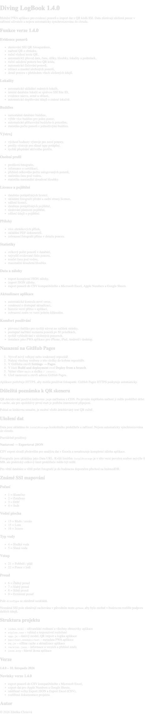

# Diving LogBook 1.4.0

Mobilní PWA aplikace pro evidenci ponorů a import dat z QR kódů SSI. Data zůstávají uložená pouze v zařízení uživatele a nejsou automaticky synchronizována do cloudu.

## Funkce verze 1.4.0

### Evidence ponorů

- skenování SSI QR fotoaparátem,
- načtení QR z obrázku,
- ruční vložení textu QR,
- automatický převod data, času, délky, hloubky, lokality a podmínek,
- ruční založení ponoru bez QR kódu,
- automatické číslování ponorů,
- editace a mazání uložených ponorů,
- detail ponoru s přehledem všech uložených údajů.

### Lokality

- automatické ukládání známých lokalit,
- interní databáze lokalit se správou SSI Site ID,
- evidence názvu, země a oblasti,
- automatické doplňování údajů o známé lokalitě.

### Buddies

- samostatná databáze buddies,
- výběr více buddies pro jeden ponor,
- automatické přiřazování buddyho k ponorům,
- statistika počtu ponorů s jednotlivými buddies.

### Výstroj

- výchozí hodnoty výstroje pro nové ponory,
- profily výstroje pro různé typy potápění,
- rychlé přepínání aktivního profilu.

### Osobní profil

- profilová fotografie,
- informace o certifikaci,
- přehled celkového počtu zalogovaných ponorů,
- statistika času pod vodou,
- statistika maximální dosažené hloubky.

### Licence a pojištění

- databáze potápěčských licencí,
- ukládání fotografií přední a zadní strany licence,
- sdílení licencí,
- databáze potápěčských pojištění,
- sledování platnosti pojištění,
- sdílení údajů o pojištění.

### Přílohy

- více obrázkových příloh,
- ukládání PDF dokumentů,
- zobrazení fotografií přímo v detailu ponoru.

### Statistiky

- celkový počet ponorů v databázi,
- nejvyšší evidované číslo ponoru,
- součet času pod vodou,
- maximální dosažená hloubka.

### Data a zálohy

- export kompletní JSON zálohy,
- import JSON zálohy,
- export ponorů do CSV kompatibilního s Microsoft Excel, Apple Numbers a Google Sheets.

### Aktualizace aplikace

- automatická kontrola nové verze,
- oznámení o dostupné aktualizaci,
- historie verzí přímo v aplikaci,
- zobrazení změn ve verzi jedním kliknutím.

### Komfort používání

- plovoucí tlačítko pro rychlý návrat na začátek stránky,
- postupné načítání seznamu ponorů po 50 položkách,
- rychlé vyhledávání v uložených ponorech,
- instalace jako PWA aplikace pro iPhone, iPad, Android i desktop.

## Nasazení na GitHub Pages

1. Vytvoř nový veřejný nebo soukromý repozitář.
2. Nahraj všechny soubory z této složky do kořene repozitáře.
3. V GitHubu otevři **Settings → Pages**.
4. V části **Build and deployment** zvol **Deploy from a branch**.
5. Vyber větev `main` a složku `/ (root)`.
6. Ulož nastavení a otevři adresu GitHub Pages.

Aplikace potřebuje HTTPS, aby mohla používat fotoaparát. GitHub Pages HTTPS poskytuje automaticky.

## Důležitá poznámka k QR skeneru

QR dekódování používá knihovnu `jsQR` načítanou z CDN. Po prvním úspěšném načtení ji může prohlížeč držet v cache, ale pro spolehlivý první start je potřeba internetové připojení.

Pokud se knihovna nenačte, je možné vložit dekódovaný text QR ručně.

## Uložení dat

Data jsou ukládána do `localStorage` konkrétního prohlížeče a zařízení. Nejsou automaticky synchronizována do cloudu.

Pravidelně používej:

**Nastavení → Exportovat JSON**

CSV export slouží především pro analýzu dat v Excelu a nenahrazuje kompletní zálohu aplikace.

Fotografie jsou ukládány jako Data URL. Kvůli limitům `localStorage` je v této verzi povolen soubor nejvýše 6 MB, ale praktický celkový limit prohlížeče může být nižší.

Pro větší databáze a větší počet fotografií je do budoucna doporučen přechod na IndexedDB.

## Známé SSI mapování

### Počasí

- 1 = Slunečno
- 2 = Zataženo
- 3 = Déšť
- 4 = Sníh

### Vodní plocha

- 13 = Moře / oceán
- 15 = Lom
- 16 = Jezero

### Typ vody

- 4 = Sladká voda
- 5 = Slaná voda

### Vstup

- 21 = Pobřeží / pláž
- 22 = Ponor z lodi

### Proud

- 6 = Žádný proud
- 7 = Slabý proud
- 8 = Silný proud
- 9 = Extrémní proud

Pole `diveType` se záměrně neukládá.

Neznámá SSI pole zůstávají zachována v původním textu `qrRaw`, aby bylo možné v budoucnu rozšířit podporu dalších údajů.

## Struktura projektu

- `index.html` – uživatelské rozhraní a všechny obrazovky aplikace
- `styles.css` – vzhled a responzivní rozložení
- `app.js` – datový model, QR import a logika aplikace
- `manifest.webmanifest` – metadata PWA aplikace
- `sw.js` – offline cache a aktualizace aplikace
- `version.json` – informace o verzích a přehled změn
- `icon.svg` – hlavní ikona aplikace

## Verze

**1.4.0 – 10. listopadu 2026**

### Novinky verze 1.4.0

- export ponorů do CSV kompatibilního s Microsoft Excel,
- export dat pro Apple Numbers a Google Sheets,
- oddělené volby Export JSON a Export Excel (CSV),
- rozšířená dokumentace projektu.

## Autor

© 2026 Zdeňka Chrzová